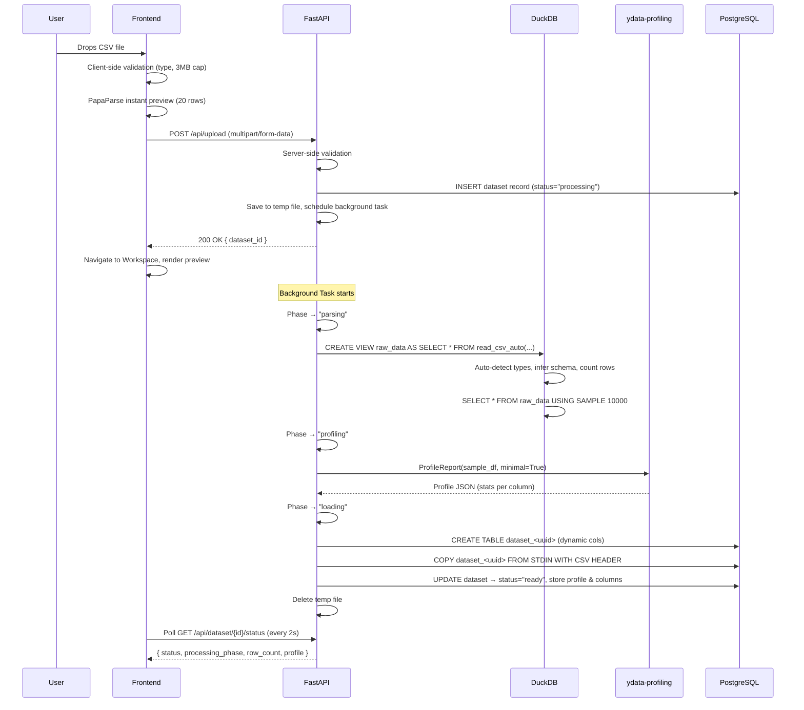
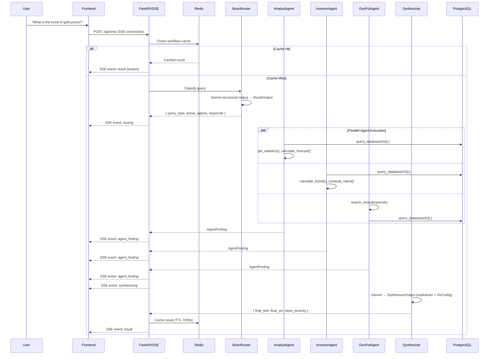
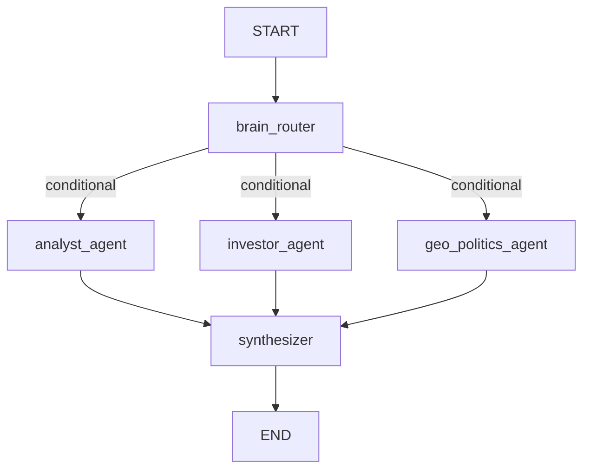

# Data-Wire — Technical Deep-Dive & Interview Reference

> A comprehensive technical document covering architecture, data flow, multi-agent orchestration, DuckDB internals, caching, resilience, and deployment — structured for interview preparation.

---

## 1. Project Overview — What Is Data-Wire?

Data-Wire is a **full-stack, multi-agent AI data analytics platform**. Users upload any CSV file, ask questions in plain English, and receive real-time AI-powered insights with auto-generated visualizations. It eliminates the need for specialized data science skills.

| Dimension | Detail |
|---|---|
| **Frontend** | React 19, Vite, Tailwind CSS, Recharts, react-simple-maps |
| **Backend** | FastAPI (Python 3.11+), Uvicorn, SSE-Starlette, structlog |
| **AI Engine** | Google Gemini 2.5 Flash via `langchain-google-genai`, LangGraph, LangChain |
| **Data Layer** | DuckDB (in-memory profiling), Supabase PostgreSQL (persistence), Upstash Redis (TLS caching) |
| **External API** | NewsData.io (geopolitical context) |
| **Deployment** | Render (backend, single-worker), Vercel (frontend) |

---

## 2. High-Level Architecture

```
┌─────────────────┐     SSE Stream       ┌─────────────────────────────────────────┐
│   React/Vite    │◄───────────────────► │             FastAPI Backend             │
│   Frontend      │     POST /api/chat   │                                         │
│                 │     POST /api/upload │  ┌─────────┐   ┌──────────────────────┐ │
│  ┌───────────┐  │                      │  │ Brain   │──►│ Agent Nodes          │ │
│  │LeftPanel  │  │                      │  │ Router  │   │(LangGraph Resilience)│ │
│  │CenterPanel│  │                      │  └─────────┘   └──────────┬───────────┘ │
│  │RightPanel │  │                      │                           │             │
│  └───────────┘  │                      │  ┌────────────────────────▼───────────┐ │
│                 │                      │  │  Synthesizer (Gemini 2.5 Flash)    │ │
│                 │                      │  └────────────────────────────────────┘ │
└─────────────────┘                      └──────────┬───────────┬──────────────────┘
                                                    │           │
                                         ┌──────────▼──┐   ┌────▼───────────┐
                                         │  Supabase   │   │ Upstash Redis  │
                                         │  Postgres   │   │ (TLS Caching)  │
                                         └─────────────┘   └────────────────┘
```

### Interview Q: "Walk me through the architecture."

> Data-Wire follows a **three-tier architecture**: a React SPA frontend, a Python FastAPI backend, and a dual-database layer (Supabase Postgres for persistence + Upstash Redis for caching). The backend hosts a **LangGraph multi-agent pipeline** where specialized AI agents (Analyst, Investor, Geo-Politics) are dynamically routed based on query complexity. Communication between frontend and backend during query execution uses **Server-Sent Events (SSE)** for real-time streaming. Data ingestion uses **DuckDB as an in-memory engine** for sub-second CSV profiling before bulk-loading data into Postgres via `COPY STDIN`.

---

## 3. Complete Data Flow — End-to-End

### 3.1 CSV Upload & Ingestion Pipeline



#### Key Technical Details:

| Step | File | What Happens |
|---|---|---|
| Upload endpoint | [upload.py](file:///c:/GAME/data-wire/backend/api/upload.py) | Validates file type & 3MB size limit, creates `Dataset` record, saves to temp, schedules `process_large_csv_background` |
| DuckDB profiling | [data_processing.py](file:///c:/GAME/data-wire/backend/services/data_processing.py#L11-L50) | `read_csv_auto()` with `sample_size=10000` for type inference; `DESCRIBE` for schema; `USING SAMPLE 10000` for profiling sample |
| ydata-profiling | [data_processing.py](file:///c:/GAME/data-wire/backend/services/data_processing.py#L52-L81) | **Lazy-loaded** (`from ydata_profiling import ProfileReport` inside function body) to save ~200MB boot-time RAM |
| Bulk insert | [data_processing.py](file:///c:/GAME/data-wire/backend/services/data_processing.py#L83-L137) | DuckDB types → Postgres type mapping; `COPY FROM STDIN WITH CSV HEADER` via psycopg2 `copy_expert` |
| Phase tracking | [data_processing.py](file:///c:/GAME/data-wire/backend/services/data_processing.py#L150-L161) | `_set_phase()` commits phase updates (`parsing` → `profiling` → `loading`) so the frontend polling can show granular progress |
| Status polling | [status.py](file:///c:/GAME/data-wire/backend/api/status.py) | Returns status, processing_phase, row_count, column_count, and full profile JSON when ready |

### Interview Q: "Why use DuckDB instead of just pandas.read_csv()?"

> **DuckDB provides sub-second profiling on large CSVs**. Its `read_csv_auto()` function performs automatic type inference with configurable sample sizes (we use 10,000 rows), automatic header detection, and columnar in-memory processing — all without loading the entire file into a pandas DataFrame first. DuckDB's `DESCRIBE` command instantly returns the schema, and `USING SAMPLE 10000` efficiently draws a statistical sample for profiling. Compared to pandas, DuckDB uses columnar storage (not row-based), which is dramatically faster for aggregation and schema inference. It also uses less peak memory because it doesn't need to materialise the entire DataFrame. After profiling, the raw CSV is bulk-loaded into Postgres via `COPY STDIN` — DuckDB is only used transiently as an in-memory engine.

### Interview Q: "Why a background task instead of processing synchronously?"

> The upload endpoint returns immediately with a `dataset_id` so the user isn't blocked. DuckDB profiling + ydata-profiling + Postgres COPY involves I/O-heavy work that can take 5–20 seconds. FastAPI's `BackgroundTasks` offloads this from the request/response cycle. The background task creates its **own database session** (`AsyncSessionLocal()`) because the request-scoped session from `Depends(get_db)` is already closed by the time the background task runs — using it would silently fail on commit. The frontend polls `/api/dataset/{id}/status` every 2 seconds to track progress.

---

### 3.2 Query & Multi-Agent Analysis Pipeline



---

## 4. Multi-Agent Orchestration — LangGraph Deep Dive

### 4.1 The StateGraph Architecture

The multi-agent pipeline is implemented as a **LangGraph `StateGraph`** defined in [workflow.py](file:///c:/GAME/data-wire/backend/agents/workflow.py).



#### The State Object — `DataWireState`

Defined in [state.py](file:///c:/GAME/data-wire/backend/agents/state.py):

```python
class DataWireState(TypedDict):
    messages: List[BaseMessage]
    user_query: str
    dataset_id: str
    data_schema: List[dict]        # Column names & types
    data_sample: List[dict]        # Sample rows (currently empty, tools query directly)
    data_profile: Optional[dict]   # Pre-computed ydata-profiling output
    query_type: str                # 'data' | 'trend' | 'comparison' | 'risk' | 'general'
    active_agents: List[str]       # Which agents to fire
    extracted_keywords: List[str]  # For news search
    agent_findings: Annotated[List[AgentFinding], operator.add]  # ← KEY: reducer annotation
    debate_round: int
    final_text: str
    final_viz: Optional[dict]      # VizConfig from synthesizer
    final_viz_type: str
    news_severity: str             # CRITICAL | HIGH | MEDIUM | LOW
```

> [!IMPORTANT]
> The `agent_findings` field uses `Annotated[List[AgentFinding], operator.add]` — this is the **LangGraph reducer annotation** that enables parallel agents to independently append their findings to the same list. Without this, parallel nodes would overwrite each other's outputs. `operator.add` merges lists from all parallel branches.

### 4.2 Brain Router — Smart Query Classification

Defined in [brain.py](file:///c:/GAME/data-wire/backend/agents/brain.py#L43-L63):

The Brain Router is the **entry node** that classifies the user's query and determines which agents to activate:

| Query Pattern | Active Agents | Rationale |
|---|---|---|
| Simple data point / aggregation (e.g., "What is the average X?") | `['analyst_agent']` | Single agent saves API calls |
| Trends / Growth / Scenarios | `['analyst_agent', 'investor_agent']` | Two perspectives needed |
| Risk / External / Broad comparisons | All three agents | Full multi-agent debate |

**Implementation:**
- Uses Gemini's **`with_structured_output(RouteOutput, method="json_schema")`** for deterministic JSON schema output
- Wrapped in `@retry` from `tenacity` (2 attempts, exponential backoff)
- **Fallback on total failure**: defaults to activating all three agents (fail-open, not fail-closed)

```python
class RouteOutput(BaseModel):
    query_type: Literal['data', 'trend', 'comparison', 'risk', 'general']
    keywords: List[str]
    active_agents: List[str]  # 'analyst_agent', 'investor_agent', 'geo_politics_agent'
```

### Interview Q: "How does the router decide which agents to activate?"

> The router uses Gemini 2.5 Flash with **native JSON schema structured output** (`method="json_schema"`) to classify the query into a `RouteOutput` Pydantic model. The prompt explicitly maps query complexity to agent combinations: simple aggregations → analyst only, trend/growth queries → analyst + investor, risk/broad/comparison queries → all three. This is a **cost-optimization strategy**: simple queries consume 1 API call instead of 3. The router has a tenacity retry (2 attempts, exponential backoff) and fails open — if classification fails completely, all agents are activated to maximize coverage.

### 4.3 Conditional Edge Routing — `distribute_agents`

```python
workflow.add_conditional_edges(
    "brain_router",
    distribute_agents,  # Returns state["active_agents"] → e.g., ["analyst_agent", "investor_agent"]
    {
        "analyst_agent": "analyst_agent",
        "investor_agent": "investor_agent",
        "geo_politics_agent": "geo_politics_agent"
    }
)
```

The `distribute_agents` function simply returns `state["active_agents"]` — a list of node names. **LangGraph executes all returned nodes in parallel**.

### 4.4 Agent Node Factory — `create_agent_node`

Each agent is created via a **factory function** ([workflow.py](file:///c:/GAME/data-wire/backend/agents/workflow.py#L28-L76)):

```python
def create_agent_node(persona_name, base_persona, tools, llm):
    def node(state: DataWireState):
        try:
            prompt = build_agent_prompt(persona_name, base_persona, state["data_schema"], ...)
            agent = create_react_agent(llm, tools=tools, prompt=prompt)
            result = agent.invoke({"messages": [HumanMessage(content=state["user_query"])]})
            finding = AgentFinding(agent_name=..., finding=result, confidence=1.0, ...)
        except Exception as e:
            # FAULT ISOLATION: Degraded finding instead of crashing the entire pipeline
            finding = AgentFinding(agent_name=..., finding="...error...", confidence=0.0, challenges=[str(e)])
        return {"agent_findings": [finding]}
    return node
```

#### Key Design Decisions:

1. **`create_react_agent`** from LangGraph's prebuilt module — creates a ReAct (Reasoning + Acting) agent with automatic tool-calling loops and retry
2. **Fault Isolation**: Every agent is wrapped in `try/except`. If an agent crashes (LLM timeout, tool error, rate limit), it returns a degraded `AgentFinding` with `confidence=0.0` instead of killing the entire graph
3. **Dynamic Prompt Injection**: `build_agent_prompt()` injects the dataset schema, column stats, table name, and dataset_id directly into the system prompt

### 4.5 Agent Personas & Tools

Defined in [personas.py](file:///c:/GAME/data-wire/backend/agents/personas.py) and [tools.py](file:///c:/GAME/data-wire/backend/agents/tools.py):

| Agent | Persona | Tools | Temperature |
|---|---|---|---|
| **Analyst** | Senior quantitative data analyst — hypothesis testing, SQL analysis, forecasting | `query_database`, `get_statistics`, `calculate_forecast` | 0.4 |
| **Investor** | Financial analyst — metrics, growth trends, scenario modelling (Bull/Base/Bear) | `query_database`, `calculate_trends`, `compute_ratios` | 0.4 |
| **Geo-Politics** | Geopolitical risk analyst — news correlation, risk classification | `query_database`, `search_news` | 0.4 |
| **Brain** | Router + Synthesizer — deterministic routing and final report generation | (no tools, uses structured output) | 0.1 |

### Interview Q: "What tools do the agents have and how do they work?"

> Each agent has LangChain `@tool`-decorated functions:
> - **`query_database(sql, dataset_id)`**: Executes read-only SQL SELECTs against the dynamic Postgres table. Has a safety guard that rejects non-SELECT queries. Results are cached in Redis (1-hour TTL) using an MD5 hash of the SQL as cache key. Results are truncated to 10 rows with a warning to use GROUP BY for larger result sets.
> - **`get_statistics(column, dataset_id)`**: Runs `pandas.describe()` on a single column for descriptive stats.
> - **`calculate_forecast(column, periods, dataset_id)`**: Uses `scipy.stats.linregress` for linear regression forecasting. Returns trend direction, R², and predicted values. Requires minimum 5 data points.
> - **`calculate_trends(column, dataset_id)`**: Computes period-over-period percentage growth rates using `pandas.pct_change()`.
> - **`compute_ratios(numerator_col, denominator_col, dataset_id)`**: Row-by-row ratio computation with division-by-zero protection.
> - **`search_news(keywords)`**: Calls NewsData.io API with retry (3 attempts, exponential backoff). Results cached in Redis for 1 hour.

### 4.6 Master Synthesizer

Defined in [brain.py](file:///c:/GAME/data-wire/backend/agents/brain.py#L68-L125):

The synthesizer receives all `agent_findings` and produces:

```python
class SynthesizerOutput(BaseModel):
    markdown_report: str        # Cohesive markdown analysis
    viz_config: VizConfig       # Structured chart specification
    severity: Literal['CRITICAL', 'HIGH', 'MEDIUM', 'LOW']
```

- Uses `with_structured_output(SynthesizerOutput, method="json_schema")` for zero-schema-drift output
- Has its own retry logic (2 attempts)
- **Fallback**: If synthesis fails entirely, returns a table-type viz with empty data and a generic error message — the pipeline never returns nothing

### 4.7 Visualization Schema — `VizConfig`

Defined in [viz_schema.py](file:///c:/GAME/data-wire/backend/agents/viz_schema.py):

```python
class VizConfig(BaseModel):
    viz_type: Literal['bar', 'line', 'pie', 'scatter', 'area', 'composed', 'map', 'table']
    title: str
    x_label: Optional[str]
    y_label: Optional[str]
    data: Optional[List[ChartDataPoint]]      # Standard charts
    forecast: Optional[List[ForecastPoint]]    # Forecast extension
    map_data: Optional[List[MapDataPoint]]     # Geographic data
    color_scheme: Literal['default', 'financial', 'risk', 'geo']
    show_legend: bool
    stacked: bool
```

> [!TIP]
> **Self-Healing Data Points**: `ChartDataPoint` has `model_config = {"extra": "allow"}` and a `model_post_init` hook that **auto-maps arbitrary LLM fields** to `label`/`value`. If the LLM returns `{sector: 'Tech', ratio: 1.2}` instead of the canonical `{label: 'Tech', value: 1.2}`, the hook detects the first string extra as `label` and the first numeric extra as `value`. This prevents rendering failures from LLM schema drift.

---

## 5. DuckDB Usage — Deep Technical Details

### Where DuckDB Is Used

DuckDB is used **exclusively during CSV ingestion** as a transient in-memory analytical engine. It is NOT used at query time — queries go directly to PostgreSQL.

### Why DuckDB Over Alternatives

| Concern | DuckDB | pandas.read_csv | SQLite |
|---|---|---|---|
| Type inference | `read_csv_auto()` with configurable sample_size | Manual `dtype` hints or slow infer | No CSV auto-import |
| Speed | Columnar engine, vectorized execution | Row-based, GIL-limited | B-tree, row-oriented |
| Memory | Streaming reads, doesn't materialise full file | Full DataFrame in RAM | Disk-based |
| Schema discovery | `DESCRIBE` → instant column names + types | `df.dtypes` (after full read) | N/A |
| Sampling | `USING SAMPLE 10000` (SQL syntax) | `df.sample(10000)` (after full read) | N/A |

### The Exact DuckDB Flow

```python
con = duckdb.connect(database=':memory:')  # Ephemeral in-memory DB

# 1. Load with auto-detection (types, headers, delimiters)
con.execute("CREATE VIEW raw_data AS SELECT * FROM read_csv_auto('{file_path}', sample_size=10000);")

# 2. Schema extraction
df_schema = con.execute("DESCRIBE raw_data;").df()  # Returns DataFrame with column_name, column_type

# 3. Row count
row_count = con.execute("SELECT count(*) FROM raw_data").fetchone()[0]

# 4. Statistical sample for profiling (avoids loading all rows into pandas)
sample_df = con.execute("SELECT * FROM raw_data USING SAMPLE 10000").df()

con.close()  # Everything is discarded — DuckDB is ephemeral
```

### Interview Q: "DuckDB is in-memory, isn't that dangerous for large files?"

> DuckDB doesn't load the entire file into memory at once. `read_csv_auto()` uses streaming reads with configurable sample sizes. The `CREATE VIEW` is lazy — it doesn't materialise the data until queried. The `USING SAMPLE 10000` clause draws a statistical sample without scanning every row. Additionally, the upload endpoint enforces a **3MB file size limit** (matching Render's free-tier 512MB RAM constraint), so memory pressure is bounded. After profiling, DuckDB's connection is closed and all memory is released. The actual data persistence goes to Postgres via `COPY STDIN`, which streams from the file — not from DuckDB.

---

## 6. Database Layer — PostgreSQL (Supabase)

### 6.1 Schema Design

Defined in [models.py](file:///c:/GAME/data-wire/backend/database/models.py):

```
┌──────────────┐       ┌──────────────────┐       ┌──────────────────┐
│   datasets   │       │ dataset_columns  │       │ dataset_profiles │
├──────────────┤       ├──────────────────┤       ├──────────────────┤
│ id (PK, UUID)│──┐    │ id (PK, UUID)    │       │ id (PK, UUID)    │
│ filename     │  │    │ dataset_id (FK)──│───┐   │ dataset_id (FK)──│───┐
│ original_fn  │  │    │ name             │   │   │ profile_json     │   │
│ status       │  │    │ dtype            │   │   └──────────────────┘   │
│ row_count    │  │    │ nullable_count   │   │                         │
│ column_count │  │    │ unique_count     │   │                         │
│ table_name   │  └────│──────────────────│───┘                         │
│ error_message│       └──────────────────┘       (CASCADE on delete)   │
│ processing_  │                                                        │
│   phase      │                                                        │
│ created_at   │                                                        │
└──────────────┘                                                        │
                                                                        │
┌──────────────────────────┐                                            │
│ dataset_<uuid> (dynamic) │  ← Created per upload via bulk_insert      │
│ Dynamic columns from CSV │                                            │
└──────────────────────────┘                                            │
```

### 6.2 Dynamic Table Creation

For each uploaded CSV, a **dedicated Postgres table** is created:

- Table name: `dataset_{uuid_with_underscores}` (hyphens replaced with underscores)
- Column types are mapped from DuckDB types: `BIGINT` → `BIGINT`, `DOUBLE` → `DOUBLE PRECISION`, `VARCHAR` → `TEXT`, etc.
- Data is loaded via **`COPY FROM STDIN WITH CSV HEADER`** — the fastest Postgres bulk insert method

### 6.3 Connection Management

Defined in [connection.py](file:///c:/GAME/data-wire/backend/database/connection.py):

- **Async**: SQLAlchemy `create_async_engine` with `asyncpg` driver for all ORM operations (datasets metadata, profiles, columns)
- **Sync**: Raw `psycopg2` connections for `COPY STDIN` bulk inserts and agent SQL tool queries (LangChain tools are synchronous)
- **SSL**: Supabase connections require SSL — `connect_args={"ssl": "require"}` is conditionally applied when `supabase` appears in the URL
- **Pool**: `pool_size=5`, `max_overflow=10` — conservative for Supabase free tier

### Interview Q: "Why two different database drivers (asyncpg + psycopg2)?"

> FastAPI is an async framework, so the ORM operations (metadata CRUD, session management, status polling) use SQLAlchemy's `asyncpg` driver for non-blocking I/O. However, the `COPY FROM STDIN` protocol and the agent tools' SQL execution are **synchronous** operations — `asyncpg` doesn't support the `COPY` protocol natively, and LangChain's `@tool` functions are synchronous. So `psycopg2` is used for these specific operations. The URL is converted between formats: `postgresql+asyncpg://` for async and `postgresql://` for sync.

---

## 7. Caching Architecture — Redis

### 7.1 Redis Client Singleton

Defined in [redis.py](file:///c:/GAME/data-wire/backend/database/redis.py):

```python
_redis_client = None  # Module-level singleton
_HEALTH_CHECK_INTERVAL = 60  # Ping every 60 seconds

def get_redis_client():
    # Returns singleton or None if unavailable
    # Auto-reconnects on stale connections
    # Health check: periodic ping() to detect dead TLS connections
```

**Key features:**
- **Lazy singleton** — created on first call, reused globally
- **60-second health checks** — periodically pings Redis to detect dead connections
- **Auto-recovery** — if ping fails, resets singleton and retries once
- **Graceful degradation** — returns `None` if Redis is unreachable; callers handle this

### 7.2 What Gets Cached

| Cache Key Pattern | TTL | What's Cached | Where |
|---|---|---|---|
| `sql:{dataset_id}:{md5(sql)}` | 1 hour | Raw SQL query results | [tools.py](file:///c:/GAME/data-wire/backend/agents/tools.py#L40-L71) |
| `news:{md5(query)}` | 1 hour | NewsData.io API responses | [news_client.py](file:///c:/GAME/data-wire/backend/utils/news_client.py#L33-L64) |
| `workflow:{dataset_id}:{md5(normalized_query)}` | 2 hours | Entire workflow output (text + viz + severity) | [chat.py](file:///c:/GAME/data-wire/backend/api/chat.py#L72-L97) |

### 7.3 Semantic Query Normalization

Before checking the workflow cache, user queries are normalized ([chat.py](file:///c:/GAME/data-wire/backend/api/chat.py#L18-L24)):

```python
def normalize_query(query: str) -> str:
    query = query.lower()
    query = re.sub(r'[^a-z0-9\s]', '', query)       # Strip punctuation
    words = query.split()
    stop_words = {"what", "is", "the", "a", "show", "me", "give", "tell", ...}
    filtered = sorted([w for w in words if w not in stop_words])
    return "_".join(filtered)
```

This means "Show me the average price" and "What is the average price?" hit the **same cache key**.

### Interview Q: "How does caching work? What's the cache invalidation strategy?"

> Three-layer caching: SQL results (1h TTL), news results (1h TTL), and full workflow outputs (2h TTL). The workflow cache uses **semantic normalization** — queries are lowercased, punctuation-stripped, stop-words removed, and alphabetically sorted before hashing, so semantically identical queries share a cache key. Cache invalidation is purely TTL-based (no explicit invalidation) because the underlying CSV data is immutable once uploaded. Every Redis call is wrapped in its own `try/except` so a dead Redis connection **never kills the analysis pipeline** — it just bypasses caching and runs the full pipeline.

---

## 8. SSE Streaming — Real-Time Communication

### 8.1 Backend: SSE Event Generator

Defined in [chat.py](file:///c:/GAME/data-wire/backend/api/chat.py#L76-L183):

The `/api/chat` endpoint returns an `EventSourceResponse` (from `sse-starlette`) with an async generator that yields structured events:

| SSE Event | When | Payload |
|---|---|---|
| `routing` | Brain Router completes | `{ query_type, active_agents }` |
| `agent_finding` | Each agent completes | `{ agent_name, finding }` |
| `synthesizing` | Synthesizer starts | `{}` |
| `result` | Final output ready | `{ text, viz, news_severity }` |
| `error` | Pipeline failure | `{ code, message }` |

**Implementation details:**
- Uses `app_workflow.astream(initial_state, stream_mode="updates")` — LangGraph's streaming API that yields state diffs after each node
- Each payload is a dict with `{node_name: state_update}` — the handler maps node names to SSE event types
- `await asyncio.sleep(0.01)` after each yield to flush SSE bits immediately
- Checks `await request.is_disconnected()` to stop processing if the client disconnects

### 8.2 Frontend: SSE Consumer

Defined in [chat.js](file:///c:/GAME/data-wire/frontend/src/api/chat.js):

```javascript
// Manual ReadableStream-based SSE parsing (not EventSource API)
const reader = res.body.getReader();
let buffer = '';
let currentEvent = null;
let currentData = '';

// Parse SSE wire format: "event: routing\ndata: {...}\n\n"
// Handles TCP chunk boundaries (data split across reads)
// Handles multiline data payloads (appends instead of overwrites)
// Cleans \r from sse-starlette's \r\n line endings
```

### Interview Q: "Why not use the native EventSource API?"

> The native `EventSource` API only supports GET requests. The `/api/chat` endpoint requires a POST (to send the query body and dataset_id). Using `fetch()` with `ReadableStream.getReader()` provides full control: we can send POST bodies, handle `AbortController` cancellation, implement custom retry logic, and parse multiline SSE `data:` payloads that span TCP chunk boundaries. The frontend manages its own SSE wire-format parser that accumulates data across chunk boundaries and dispatches callbacks (`onRouting`, `onAgentFinding`, `onSynthesizing`, `onResult`, `onError`).

---

## 9. LLM Configuration — Gemini Round-Robin

Defined in [llm.py](file:///c:/GAME/data-wire/backend/utils/llm.py):

### 5-Key Round-Robin Pool

```python
GEMINI_KEYS = [os.getenv(f"GEMINI_API_KEY_{i}") for i in range(1, 6)]
_key_cycle = itertools.cycle(GEMINI_KEYS)  # Infinite circular iterator
_key_lock = threading.Lock()                # Thread-safe access

def _next_key() -> str:
    with _key_lock:
        return next(_key_cycle)
```

- **Free-tier Gemini**: 15 RPM per key → 5 keys = **~75 RPM effective throughput**
- Thread-safe via `threading.Lock()` because LangGraph agents may run in parallel threads
- 4 LLM instances are pre-created at import time:
  - `brain_llm` (temp=0.1) — deterministic routing + synthesis
  - `analyst_llm`, `investor_llm`, `geopol_llm` (temp=0.4) — creative analytical reasoning

### Interview Q: "How do you handle rate limiting with the free tier?"

> We use a **5-key round-robin rotation** strategy. Five Gemini API keys are loaded from environment variables and cycled through using `itertools.cycle()` with a `threading.Lock()` for thread safety. Each new LLM instance gets the next key in the rotation. This effectively multiplies the free-tier rate limit from 15 RPM to ~75 RPM. The Brain Router's lower temperature (0.1) ensures deterministic routing, while agent instances use 0.4 for more creative analytical reasoning. Additionally, Gemini's native structured output (`method="json_schema"`) eliminates retry-heavy fallback chains that waste API calls.

---

## 10. Frontend Architecture

### 10.1 State Management — Context API

Defined in [appStore.jsx](file:///c:/GAME/data-wire/frontend/src/store/appStore.jsx):

The app uses **React Context API** (not Redux/Zustand) for global state:

```javascript
// Core state
screen: 'home' | 'workspace'
datasets: [{ id, filename, status, rowCount, columnCount, profile, processingPhase }]
activeDatasetId: string
messages: [{ id, role, content, newsSeverity, agent, isStreaming, error, timestamp }]
centerItems: [{ id, type: 'viz'|'dataset', content, title }]
```

**Key actions:**
- `goToWorkspace(datasetId, filename)` — navigates, creates dataset record, clears chat
- `addCenterItem(item)` — pushes viz/dataset preview to center panel
- `addMessage(msg)` / `updateLastMessage(updater)` — manages chat messages

### 10.2 Three-Panel Layout

The workspace uses a **responsive three-panel layout** ([WorkspaceLayout.jsx](file:///c:/GAME/data-wire/frontend/src/components/workspace/WorkspaceLayout.jsx)):

| Panel | Component | Purpose |
|---|---|---|
| **Left** | [LeftPanel.jsx](file:///c:/GAME/data-wire/frontend/src/components/workspace/LeftPanel.jsx) | Dataset list, upload button, processing progress bar, status polling |
| **Center** | [CenterPanel.jsx](file:///c:/GAME/data-wire/frontend/src/components/workspace/CenterPanel.jsx) | Visual canvas — dataset previews, chart visualizations, skeleton loaders |
| **Right** | [RightPanel.jsx](file:///c:/GAME/data-wire/frontend/src/components/workspace/RightPanel.jsx) | Chat interface — messages, streaming indicators, markdown rendering |

- **Desktop**: Resizable 3-column with draggable dividers (min/max constraints)
- **Mobile/Tablet**: Tabbed single-panel with bottom tab bar and unread badge on Chat tab

### 10.3 Visualization System

The visualization layer supports **10 chart types** with a **type-switching** feature:

| Chart Type | Component | Library |
|---|---|---|
| Bar | [BarChartViz.jsx](file:///c:/GAME/data-wire/frontend/src/components/viz/BarChartViz.jsx) | Recharts |
| Line | [LineChartViz.jsx](file:///c:/GAME/data-wire/frontend/src/components/viz/LineChartViz.jsx) | Recharts |
| Area | [AreaChartViz.jsx](file:///c:/GAME/data-wire/frontend/src/components/viz/AreaChartViz.jsx) | Recharts |
| Pie | [PieChartViz.jsx](file:///c:/GAME/data-wire/frontend/src/components/viz/PieChartViz.jsx) | Recharts |
| Scatter | [ScatterChartViz.jsx](file:///c:/GAME/data-wire/frontend/src/components/viz/ScatterChartViz.jsx) | Recharts |
| Composed | [ComposedChartViz.jsx](file:///c:/GAME/data-wire/frontend/src/components/viz/ComposedChartViz.jsx) | Recharts |
| Map | [MapChartViz.jsx](file:///c:/GAME/data-wire/frontend/src/components/viz/MapChartViz.jsx) | react-simple-maps |
| Table | [TableViz.jsx](file:///c:/GAME/data-wire/frontend/src/components/viz/TableViz.jsx) | Custom HTML |

The [ChartRenderer.jsx](file:///c:/GAME/data-wire/frontend/src/components/viz/ChartRenderer.jsx) is the **orchestrator** component:
- Maps `viz_type` string → component via `VIZ_COMPONENTS` lookup (includes aliases like `trend` → `LineChartViz`)
- Allows runtime chart type switching between `bar`, `line`, `area`, `scatter`, `pie`
- Supports fullscreen expansion with backdrop blur and Escape key handling

### 10.4 Instant Preview — Zero-Wait UX

When a CSV is uploaded, the frontend **immediately parses the first 20 rows client-side** using PapaParse ([useUpload.js](file:///c:/GAME/data-wire/frontend/src/hooks/useUpload.js#L31-L51)):

```javascript
Papa.parse(file, {
    header: true,
    preview: 20,
    skipEmptyLines: true,
    complete: ({ data, meta }) => {
        addCenterItem({ type: 'dataset', content: { columns: meta.fields, rows: ... } });
    }
});
```

This means the user sees real tabular data **the instant the workspace mounts**, before any backend processing completes.

---

## 11. Resilience & Error Handling

### 11.1 Self-Healing Startup

On every server boot, [main.py](file:///c:/GAME/data-wire/backend/main.py#L58-L87) runs:

```python
# Reset datasets stuck in "processing" for >10 minutes (caused by Render restarts mid-processing)
update(Dataset)
    .where(Dataset.status == "processing")
    .where(Dataset.created_at < cutoff_10_min)
    .values(status="error", error_message="Processing was interrupted by a server restart.")
```

And auto-runs migrations:

```python
# Add processing_phase column if it doesn't exist
"ALTER TABLE datasets ADD COLUMN IF NOT EXISTS processing_phase VARCHAR(50) DEFAULT 'parsing';"
```

### 11.2 Fault Isolation Summary

| Layer | Failure Mode | Recovery |
|---|---|---|
| **Agent execution** | LLM timeout, tool error, rate limit | Degraded `AgentFinding` (confidence=0.0); other agents continue |
| **Brain Router** | Structured output parse failure | Falls back to activating all agents |
| **Synthesizer** | LLM failure after retries | Returns generic table viz + error text |
| **Redis read** | Connection lost, timeout | Bypasses cache, runs full pipeline |
| **Redis write** | Connection lost | Silently skips caching |
| **News API** | Rate limit, network error | Returns "Failed to retrieve news" string to agent |
| **SQL tool** | Bad SQL, connection error | Returns error string to agent (agent can retry with fixed SQL) |
| **Stale datasets** | Server restart mid-processing | Auto-reset to "error" on next boot |

### 11.3 Graceful Redis Degradation Pattern

Every Redis interaction follows this pattern:

```python
redis_client = get_redis_client()  # Returns None if unavailable
if redis_client:
    try:
        cached = redis_client.get(cache_key)
        if cached:
            return cached
    except Exception:
        logger.warning("cache_read_failed")
        # Fall through to non-cached path

# ... do the actual work ...

if redis_client:
    try:
        redis_client.setex(cache_key, 3600, result)
    except Exception:
        logger.warning("cache_write_failed")
        # Non-fatal: just skip caching
```

---

## 12. Deployment & Infrastructure

### 12.1 Backend — Render

- **Dockerfile**: Python 3.12-slim with `gcc` and `libpq-dev` for psycopg2/DuckDB C++ extensions
- **render.yaml**: `--workers 1` to prevent RAM multiplication on 512MB free tier
- **Lazy imports**: `ydata-profiling` is imported inside the function body, not at module level, saving ~200MB boot-time RAM
- **Single-worker concurrency**: Prevents multi-process memory duplication

### 12.2 Frontend — Vercel

- Vite build with React 19
- `VITE_API_URL` environment variable points to the Render backend

### 12.3 Environment Variables

| Variable | Purpose |
|---|---|
| `GEMINI_API_KEY_1` through `_5` | 5-key round-robin pool |
| `DATABASE_URL` | Supabase Postgres connection string |
| `REDIS_URL` | Upstash Redis with TLS (`rediss://`) |
| `NEWSDATA_API_KEY` | NewsData.io API key |
| `FRONTEND_URL` | CORS allowed origin |
| `LOG_FORMAT` | `json` (production) or `dev` (colored console) |

---

## 13. Logging — Structured Logging with structlog

The entire backend uses **structlog** for structured, machine-parseable logging:

```python
structlog.configure(
    processors=[
        structlog.contextvars.merge_contextvars,   # Request-scoped context
        structlog.stdlib.add_log_level,
        structlog.stdlib.add_logger_name,
        structlog.processors.TimeStamper(fmt="%H:%M:%S"),
        structlog.processors.StackInfoRenderer(),
        structlog.processors.UnicodeDecoder(),
        # JSON in production, colored console in dev
    ]
)
```

- **Production**: JSON lines format for log aggregators
- **Development**: Colorful, human-readable console output
- **Standard library routing**: Uvicorn and SQLAlchemy logs are also routed through structlog
- **Structured events**: Every log call includes typed key-value context (`dataset_id=`, `agent=`, `error=`)

---

## 14. Security Considerations

| Area | Implementation |
|---|---|
| **SQL Injection** | `query_database` tool rejects non-SELECT queries; column names are double-quoted in prompts |
| **CORS** | Explicit allowed origins + Vercel wildcard regex |
| **File Upload** | Type validation (`.csv` only), 3MB size limit, temp file cleanup |
| **Redis TLS** | `rediss://` protocol enforces TLS encryption |
| **Postgres SSL** | `connect_args={"ssl": "require"}` for Supabase |
| **Error Exposure** | Generic error messages to users; detailed errors only in server logs |

---

## 15. Common Interview Questions & Answers

### Q: "What happens if one agent fails?"

> The agent returns a degraded `AgentFinding` with `confidence=0.0` and an error message. The synthesizer aggregates the remaining healthy agents' findings. The pipeline never hard-fails because of a single agent — this is **partial pipeline recovery**.

### Q: "How does the system handle concurrent users?"

> Uvicorn with `--workers 1` (Render free tier constraint) serves concurrent requests through Python's async event loop. FastAPI's async handlers yield during I/O (database queries, LLM calls). Background tasks (CSV processing) run in the same event loop. LangGraph agents run synchronously but are offloaded to thread pools internally. Redis caching reduces repeated LLM calls for identical queries.

### Q: "Can you explain the LangGraph state management?"

> LangGraph uses a `TypedDict`-based `DataWireState`. The key design is the `operator.add` reducer on `agent_findings` — this allows parallel agent nodes to independently return `{"agent_findings": [finding]}`, and LangGraph automatically merges them via list concatenation. Without this reducer, parallel branches would overwrite each other. Conditional edges (`distribute_agents`) return a list of node names, telling LangGraph which parallel branches to execute. All branches converge at the synthesizer node before reaching `END`.

### Q: "Why Gemini 2.5 Flash specifically?"

> Three reasons: (1) **Free tier with structured output** — `method="json_schema"` provides zero-schema-drift JSON output, eliminating unreliable regex/retry-based output parsing. (2) **Cost** — Flash is significantly cheaper than Pro for the latency-tolerant analytical use case. (3) **Speed** — Flash has lower latency than Pro, important for the 10–15 second target response time.

### Q: "How would you scale this system?"

> (1) **Horizontal**: Move to multiple Uvicorn workers or Gunicorn with multiple workers on a larger instance. (2) **Async agents**: Convert synchronous agent tools to async using `asyncpg` directly or thread pool executors. (3) **Queue-based**: Replace FastAPI `BackgroundTasks` with Celery/Redis-backed task queue for CSV processing. (4) **Read replicas**: Use Postgres read replicas for agent queries. (5) **Key pool expansion**: Add more Gemini API keys. (6) **Dataset isolation**: Shard dynamic tables across multiple databases by tenant.

### Q: "What trade-offs did you make?"

> (1) **Single worker on Render** — sacrifices throughput for memory stability. (2) **Lazy ydata-profiling import** — 4x faster startup but slightly delayed first CSV processing. (3) **TTL-only cache invalidation** — no explicit invalidation, acceptable because uploaded CSV data is immutable. (4) **No Alembic** — uses `create_all` and startup ALTER for simplicity, not suitable for production schema migrations. (5) **Synchronous agent tools** — limits true parallelism, but simplifies LangChain tool implementation.

---

## 16. File Reference Map

| Path | Purpose |
|---|---|
| [main.py](file:///c:/GAME/data-wire/backend/main.py) | FastAPI app, CORS, lifespan (self-heal + auto-migrate), exception handlers |
| [agents/workflow.py](file:///c:/GAME/data-wire/backend/agents/workflow.py) | LangGraph StateGraph definition, agent factory, node wiring |
| [agents/brain.py](file:///c:/GAME/data-wire/backend/agents/brain.py) | Brain Router (query classification) + Master Synthesizer |
| [agents/state.py](file:///c:/GAME/data-wire/backend/agents/state.py) | `DataWireState`, `AgentFinding`, `NewsItem` TypedDicts |
| [agents/personas.py](file:///c:/GAME/data-wire/backend/agents/personas.py) | Agent persona prompts + dynamic prompt builder |
| [agents/tools.py](file:///c:/GAME/data-wire/backend/agents/tools.py) | LangChain tool implementations (SQL, stats, forecast, trends, ratios, news) |
| [agents/viz_schema.py](file:///c:/GAME/data-wire/backend/agents/viz_schema.py) | Pydantic models for visualization config (self-healing data point mapping) |
| [api/chat.py](file:///c:/GAME/data-wire/backend/api/chat.py) | SSE chat endpoint, workflow invocation, event streaming |
| [api/upload.py](file:///c:/GAME/data-wire/backend/api/upload.py) | CSV upload endpoint, background task scheduling |
| [api/status.py](file:///c:/GAME/data-wire/backend/api/status.py) | Dataset status polling endpoint |
| [services/data_processing.py](file:///c:/GAME/data-wire/backend/services/data_processing.py) | DuckDB profiling, ydata-profiling, Postgres COPY, background orchestration |
| [database/connection.py](file:///c:/GAME/data-wire/backend/database/connection.py) | Async engine, session factory, SSL config |
| [database/models.py](file:///c:/GAME/data-wire/backend/database/models.py) | SQLAlchemy ORM models (Dataset, DatasetColumn, DatasetProfile) |
| [database/redis.py](file:///c:/GAME/data-wire/backend/database/redis.py) | Redis singleton with health checks and auto-recovery |
| [utils/llm.py](file:///c:/GAME/data-wire/backend/utils/llm.py) | 5-key Gemini round-robin pool, LLM instance factory |
| [utils/news_client.py](file:///c:/GAME/data-wire/backend/utils/news_client.py) | NewsData.io client with retry and Redis caching |
| [frontend/src/store/appStore.jsx](file:///c:/GAME/data-wire/frontend/src/store/appStore.jsx) | React Context global state |
| [frontend/src/api/chat.js](file:///c:/GAME/data-wire/frontend/src/api/chat.js) | SSE ReadableStream parser with callback dispatch |
| [frontend/src/hooks/useChat.js](file:///c:/GAME/data-wire/frontend/src/hooks/useChat.js) | Chat hook — streaming state, message management |
| [frontend/src/hooks/useUpload.js](file:///c:/GAME/data-wire/frontend/src/hooks/useUpload.js) | Upload hook — validation, PapaParse instant preview |
| [frontend/src/components/viz/ChartRenderer.jsx](file:///c:/GAME/data-wire/frontend/src/components/viz/ChartRenderer.jsx) | Viz orchestrator — type resolution, switching, fullscreen |
